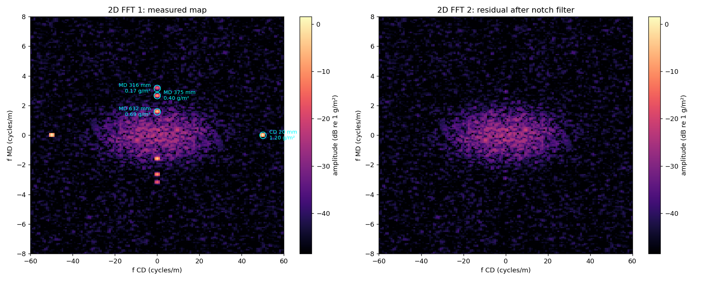
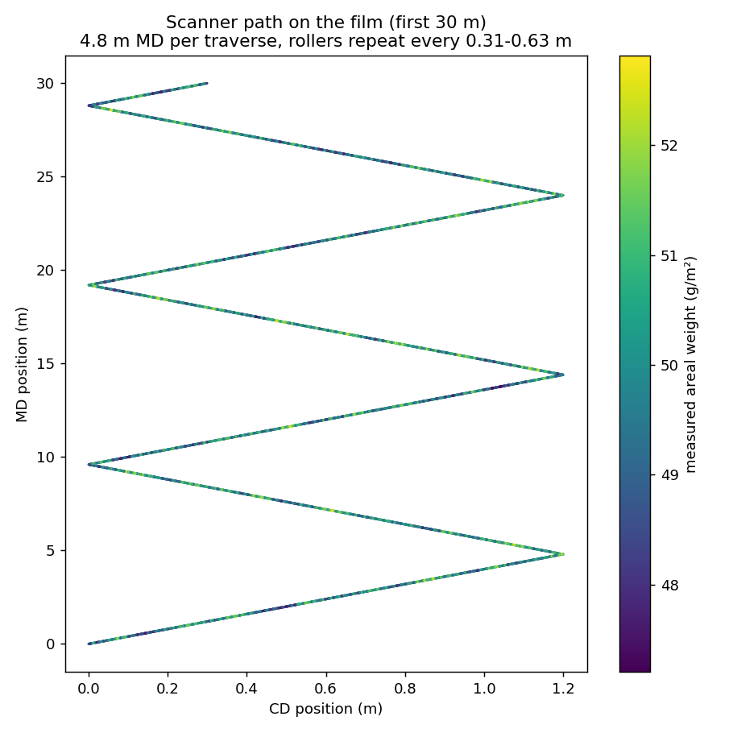
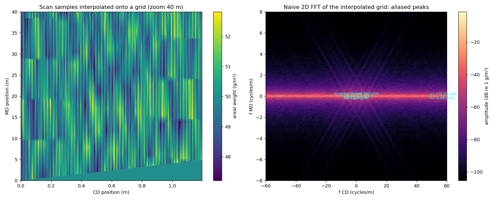
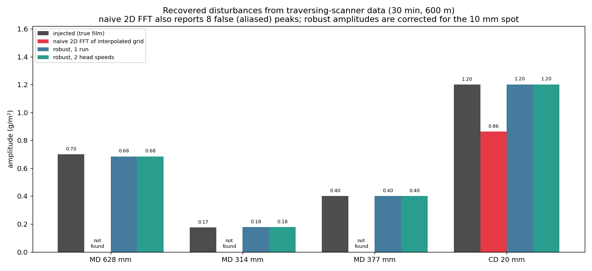
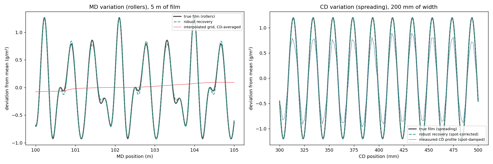

# ELTIM areal-weight simulation: UHMWPE UD film
Synthetic 2D areal-weight data (g/m²) of a UHMWPE unidirectional (UD) film, as measured by an **ELTIM ultrasonic basis-weight detector**. The data is analysed with a **2D FFT** to find periodic weight variations caused by the production line.

**Final report:** [REPORT.md](REPORT.md) covers the simulation, the traversing-scanner problem, the robust recovery method, the results, the limitations and the recommendations.



## What is simulated
The map `W(MD, CD)` covers 1.2 m film width (CD, cross direction) × 12 m length (MD, machine direction), on a 5 mm (CD) × 10 mm (MD) grid with a nominal weight of 50 g/m². It contains:

- **Random noise:**
  - white sensor/measurement noise (σ 0.8 g/m²)
  - spatially correlated material variation, the "formation" (σ 0.4 g/m²). It is elongated along the fibres (150 mm along MD, 10 mm across CD), as typical for a UD film.
- **Periodic MD disturbance (rollers):** a roller with eccentricity or a flat spot repeats once per revolution, so the period is the roller circumference.
  - Roller A, Ø 200 mm: period 628 mm, amplitude 0.70 g/m², plus a 2nd harmonic of 0.17 g/m² at 314 mm
  - Roller B, Ø 120 mm: period 377 mm, amplitude 0.40 g/m²
- **Periodic CD disturbance (spreading):** the fibre spreading pitch leaves streaks along MD, with a period of 20 mm and an amplitude of 1.2 g/m².

All values are parameters in the `Params` class at the top of `simulate_eltim.py`. Set them to match your line: roller diameters, spreader pitch, scan resolution, film width and weight.

## Analysis: two 2D FFTs
1. **2D FFT of the measured map:**
   - The map is mean-removed and Hann-windowed, and the amplitude is scaled so that a sinusoid of amplitude A gives a peak of A g/m².
   - The periodic disturbances appear as sharp peaks: rollers on the f_MD axis, spreading on the f_CD axis.
   - The peaks are detected automatically and reported with their period and amplitude.
2. **2D FFT of the residual:**
   - The detected peaks are removed with a notch filter, and the result is transformed again.
   - No peaks remain, and the residual spread equals the true random noise. This confirms that the periodic components were found and removed correctly.

Result with the default settings (`--seed 1`):
- **Detected:** CD 20.0 mm (1.20 g/m²), MD 632 mm (0.69 g/m²), MD 375 mm (0.40 g/m²) and MD 316 mm (0.17 g/m²). These match the injected disturbances within the FFT bin resolution (1/12 m⁻¹ along MD).
- **Spread:** the total σ is 1.36 g/m². The residual σ after filtering is 0.89 g/m², equal to the true random noise.

## Outputs (`outputs/`)
- `01_map_and_profiles.png`: the map, the MD profile (rollers) and the CD profile (spreading)
- `02_fft2d_measured_vs_residual.png`: both 2D FFTs on the same colour scale, with the detected peaks labelled
- `03_decomposition_zoom.png`: measured map = periodic part + residual (zoom 0.3 m × 4 m)
- `eltim_synthetic.npz`:
  - positions (`x_cd_m`, `y_md_m`)
  - maps (`gsm`, `periodic`, `residual`)
  - FFT axes (`fx`, `fy`) and FFT amplitude (`fft_amplitude`)
- `eltim_synthetic_gsm.csv`: the areal-weight map (rows = MD, columns = CD)
- `04_scan_path.png` to `07_cd_profile.png`: traversing scanner simulation, analysis steps (see below)
- `08_comparison_amplitudes.png`: recovered amplitudes, naive 2D FFT versus robust recovery
- `09_reconstruction_vs_truth.png`: reconstructed MD and CD variation compared with the true film

## Usage
Requirements: Python 3.10+.
```powershell
pip install -r requirements.txt
python simulate_eltim.py            # default realisation (seed 1)
python simulate_eltim.py --seed 7   # different random noise and phases
python simulate_eltim.py --show     # also open the figures
```

## Traversing scanner: what the ELTIM really measures
The ELTIM head doesn't measure a dense grid. It traverses across the film while the film moves, so the samples lie on a **zigzag path**. `scanner_simulation.py` samples the same synthetic film along that path, using the line settings:
- film speed **20 m/min**, head speed **5 m/min**, **120 samples/s**, spot **10 mm**
- one traverse of 1.2 m takes 14.4 s, during which the film moves **4.8 m** along MD
- sample spacing 0.7 mm (CD) × 2.8 mm (MD) along the path
- the 10 mm spot damps the 20 mm spreading pattern to 72 % of its real amplitude



**The problem: a naive 2D FFT.** Interpolating the scan samples onto a grid and taking a 2D FFT gives false peaks (150 mm and 92 mm, "mixed" direction) instead of the rollers. The scan lines are 4.8 m apart along MD, while the rollers repeat every 0.31–0.63 m, so they're heavily aliased. Only the CD pattern survives, and that one is still damped by the spot.



**What works:**
1. **Time spectrum of the raw sample stream** (`06_time_spectrum.png`): the samples are regular in time at 120 Hz.
   - **Rollers (MD):** each gives a fixed frequency, film speed / circumference (0.53, 0.88 and 1.06 Hz), whatever the head position.
   - **Spreading pattern (CD):** appears at head speed / pitch (4.17 Hz). The head reverses at every edge, which splits this peak into sidebands spaced 0.035 Hz apart.
   - **Telling them apart:** measure at 2 head speeds (5 and 7.5 m/min). The CD peak moves with the head speed (to 6.25 Hz); the roller peaks stay put.
2. **CD profile** (`07_cd_profile.png`): averaging 125 traverses per 2 mm CD bin removes the MD variation. The FFT of the profile gives the pitch: 20.0 mm.
3. **Least-squares model fit:** every sample has a known (CD, MD) position, so the model "mean + roller sinusoids + CD sinusoid" can be fitted directly.
   - The periods are refined first: a 0.1 mm error over 600 m of film already costs a third of the amplitude.
   - The CD amplitude is corrected for the spot.

These steps are implemented in one reusable function, **`robust_recovery()`** in `scanner_simulation.py`.
- **Inputs:** the raw samples (CD position, MD position, g/m², in time order) and the line settings (sample rate, film speed, head speed, width, spot size).
- **Optional second run:** pass a run at another head speed to classify MD and CD peaks by their behaviour.
- **Single run:** without a second run, the CD pitch from the CD profile is used to recognise the CD peaks. This works just as well in the simulation.

**Comparison** over 30 minutes of production (600 m), with amplitudes in g/m²:

| Disturbance | Injected | Naive 2D FFT | Robust, 1 run | Robust, 2 head speeds |
|---|---|---|---|---|
| MD roller A, 628 mm | 0.70 | not found | 0.68 | 0.68 |
| MD roller A 2nd harmonic, 314 mm | 0.17 | not found | 0.18 | 0.18 |
| MD roller B, 377 mm | 0.40 | not found | 0.40 | 0.40 |
| CD spreading, 20 mm | 1.20 | 0.86 (spot-damped) | 1.20 | 1.20 |

On top of that, the naive 2D FFT reports **8 false (aliased) peaks**, for example at 150 mm and 92 mm. The robust amplitudes are corrected for the 10 mm spot, and the periods match within 0.1 mm.





The reconstruction (figure 09) shows the difference most clearly:
- **Along MD:** the robust recovery follows the true roller variation closely. The interpolated grid shows an almost flat line, because the roller information is lost between the scans.
- **Across CD:** the measured profile is damped by the spot. The spot-corrected recovery matches the true spreading pattern.

**Practical advice for the line:**
- Analyse the raw ELTIM sample stream with timestamps and CD position, not the interpolated map the system displays.
- Use a long record (≥ 15–30 min) for sharp roller peaks and an accurate CD profile.
- Run once at a second head speed to separate MD from CD effects.
- A parked (fixed-point) measurement at 1 CD position gives the cleanest MD/roller spectrum.
- Patterns near or below the spot size (10 mm) are damped. The 20 mm pitch is still measurable (72 %), but a 10 mm pitch would barely be visible.

Run it with `python scanner_simulation.py`. The line settings are in the `Scanner` class.

## Applying it to real ELTIM data
**Raw scanner data (recommended):** export the raw sample stream with time, CD position (head position) and areal weight. MD position = film speed × time. Then:
```python
from scanner_simulation import robust_recovery
res = robust_recovery(x_cd, y_md, gsm, fs=120, web_speed=20/60, head_speed=5/60,
                      width=1.2, spot_d=0.010)          # optional: second=(gsm2, head_speed2)
for c in res["components"]:
    print(c["kind"], c["period_m"] * 1000, "mm", c["amplitude"], "g/m2")
```
A detected MD period divided by π gives the diameter of the roller causing it, which helps trace the source.

**Dense 2D map** (only from an array of sensors, not from a traversing scanner): replace the output of `simulate()` with the measured map, with shape `(n_md, n_cd)` in g/m² and equal spacing `dx_m` (CD) and `dy_m` (MD). Then use `fft2_amplitude`, `find_peaks` and `notch_filter` from `simulate_eltim.py`.
