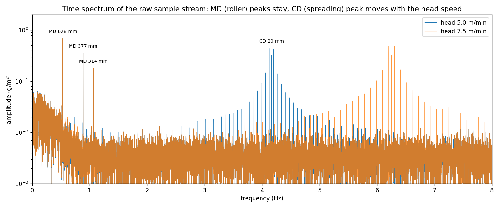
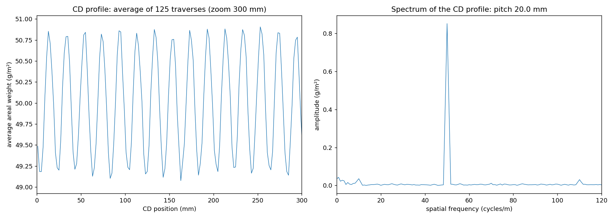

# Detecting periodic areal-weight variations in UHMWPE UD film with a traversing ELTIM scanner
**Final report: simulation study and robust recovery method**

## 1. Summary
The ELTIM ultrasonic detector measures the areal weight (g/m²) of the UHMWPE UD film. The aim is to find periodic weight variations caused by the production line, so that their source can be traced:
- **along the film (MD):** variations from rollers
- **across the film (CD):** variations from fibre spreading

This study used synthetic data with known disturbances to test how such variations can be detected.

**Main findings**
1. **On a dense 2D grid,** a 2D FFT finds all periodic disturbances correctly, with the right period and amplitude. After notch filtering, the remaining noise equals the true random noise.
2. **The ELTIM is a traversing scanner and doesn't produce a dense grid.** With the line settings (film 20 m/min, head 5 m/min, 120 samples/s, 10 mm spot), the head covers 4.8 m of film along MD per traverse. The rollers repeat every 0.31–0.63 m, so they are heavily undersampled between scans.
3. **A naive 2D FFT of interpolated scanner data fails.** None of the roller disturbances is found, the CD amplitude is underestimated by 28 % (spot damping), and 8 false (aliased) peaks appear.
4. **The robust recovery method developed here recovers all disturbances correctly** from the raw scanner data: periods within 0.1 mm and amplitudes within 0.02 g/m². It works with a single run; a second run at another head speed is optional confirmation.
5. **Practical consequence:** analyse the raw ELTIM sample stream (time, head position, g/m²), not the interpolated map the system displays.

## 2. Background
### 2.1 Film and measurement
- **Product:** UHMWPE unidirectional (UD) film, nominal areal weight about 50 g/m², width 1.2 m.
- **Sensor:** ELTIM ultrasonic basis-weight gauge with a 10 mm measuring spot, sampling at about 120 measurements per second.
- **Scanning:** the head traverses across the film at about 5 m/min while the film runs at about 20 m/min.

### 2.2 Expected disturbances
- **Rollers (MD):** an eccentric roller, a roller with a flat spot or a dirty roller repeats once per revolution. The MD period is the roller circumference (π × diameter), so a detected period points directly to a roller diameter.
- **Fibre spreading (CD):** the spreading of the fibre tows leaves a regular pattern across the width (streaks along MD) with the tow or spreader pitch as period.
- **Random variation:** sensor noise and material variation ("formation"). In a UD film the formation is elongated along the fibre direction (MD).

## 3. Simulation model
All parameters are in the code: `Params` in `simulate_eltim.py` and `Scanner` in `scanner_simulation.py`.

| Component | Model | Value |
|---|---|---|
| Mean areal weight | constant | 50 g/m² |
| Sensor noise | white | σ 0.8 g/m² |
| Formation | correlated noise, 150 mm (MD) × 10 mm (CD) | σ 0.4 g/m² |
| Roller A | MD sinusoid, Ø 200 mm, period 628.3 mm | 0.70 g/m² |
| Roller A, 2nd harmonic | MD sinusoid, period 314.2 mm | 0.17 g/m² |
| Roller B | MD sinusoid, Ø 120 mm, period 377.0 mm | 0.40 g/m² |
| Fibre spreading | CD sinusoid, pitch 20 mm | 1.20 g/m² |

The measuring spot is modelled as a circular averaging area. A sinusoidal pattern with spatial frequency *f* is damped by the factor 2·J₁(π·d·f)/(π·d·f). For d = 10 mm and the 20 mm pitch this gives **0.72**. The roller periods are practically undamped (> 0.99).

Two sampling cases were simulated:
1. **Dense grid** (`simulate_eltim.py`): 1.2 m × 12 m on a 5 mm (CD) × 10 mm (MD) grid. This is a reference case; it would need a sensor array.
2. **Traversing scanner** (`scanner_simulation.py`): samples taken along the zigzag path of the head over 30 minutes of production (600 m of film).
   - Head speed 5 m/min, plus a second run at 7.5 m/min for the MD/CD classification.
   - The head reverses instantly at the edges.

## 4. Results: dense grid (reference)


The 2D FFT of the dense map (Hann window, amplitude-scaled) shows the disturbances as sharp peaks:
- **rollers** on the f_MD axis
- **spreading** on the f_CD axis

| Disturbance | Injected | Detected (2D FFT) |
|---|---|---|
| CD spreading | 20.0 mm, 1.20 g/m² | 20.0 mm, 1.20 g/m² |
| Roller A | 628.3 mm, 0.70 g/m² | 631.6 mm, 0.69 g/m² |
| Roller B | 377.0 mm, 0.40 g/m² | 375.0 mm, 0.40 g/m² |
| Roller A, 2nd harmonic | 314.2 mm, 0.17 g/m² | 315.8 mm, 0.17 g/m² |

- The small period differences come from the FFT bin resolution (1/12 m⁻¹ along MD over 12 m).
- After notch filtering of the detected peaks, the second 2D FFT shows no peaks. The residual standard deviation (0.89 g/m²) equals that of the true random noise (0.89 g/m²). The total standard deviation of the map is 1.36 g/m², so the periodic disturbances account for most of the excess variation.

## 5. Results: traversing scanner
### 5.1 Sampling geometry
| Quantity | Value |
|---|---|
| Traverse time (1.2 m at 5 m/min) | 14.4 s |
| Film advance per traverse | **4.8 m** |
| Sample spacing along the path | 0.69 mm (CD) × 2.78 mm (MD) |
| Traverses in 30 min | 125 |
| Spot damping at the 20 mm pitch | 0.72 |


The scan lines are steep (4 m of MD per metre of CD) and 4.8 m apart along MD. The roller periods (0.31–0.63 m) are far shorter than that, so the MD direction is undersampled by a factor of about 15 between traverses.

### 5.2 Naive approach: 2D FFT of interpolated scanner data
The samples of the first 120 m were linearly interpolated onto a regular grid, and the 2D FFT was computed as for the dense case.


- **No roller found:** none of the three MD disturbances is detected.
- **8 false peaks** in "mixed" directions, for example at 150 mm and 92 mm. These are aliases of the roller pattern along the diagonal scan lines.
- **CD pattern underestimated:** the spreading pattern is found at the right pitch, but at 0.86 g/m² instead of 1.20 g/m², because of the spot damping.

**Conclusion:** a 2D FFT of an interpolated scanner map is unreliable for MD disturbances and gives misleading peaks.

### 5.3 Robust recovery method
The robust method works on the raw sample stream: CD position *x*, MD position *y* and areal weight *w* of every sample, in time order. It's implemented as `robust_recovery()` in `scanner_simulation.py`.

**Step 1: time spectrum.** The samples are equally spaced in time (120 Hz), so a regular FFT of the stream can be used.
- A **roller** disturbance appears at f = v_film / circumference, independent of the head position. Here: 0.531, 0.884 and 1.061 Hz.
- The **spreading** pattern appears at f = v_head / pitch. Here: 4.17 Hz.
- Because the head reverses at every edge, the CD peak is split into sidebands spaced 1/(2 × traverse time) = 0.035 Hz apart. These are merged into one peak (amplitude-weighted centre).



**Step 2: MD/CD classification.**
- **With two runs at different head speeds** (5 and 7.5 m/min): CD peaks move proportionally with the head speed (4.17 → 6.25 Hz), and MD peaks stay at the same frequency.
- **With a single run:** the CD pitch from step 3 predicts where the CD peak must appear (v_head / pitch). Peaks there are CD, and all others are MD.

**Step 3: CD profile.** Averaging all 125 traverses per 2 mm CD bin cancels the MD variation, because the roller phase is uncorrelated with the head position. The FFT of this profile gives the spreading pitch: **20.0 mm**. The measured amplitude is 0.85 g/m², damped by the spot.



**Step 4: period refinement and least-squares fit.**
- **Period refinement:** each period from steps 1–3 is refined with a fine search for the best-fitting sinusoid. This is essential. Without it, a period error of only 0.1 mm for roller B (from the FFT bin resolution) accumulates over 600 m of film into a large phase drift, and the fitted amplitude dropped from 0.40 to 0.28 g/m².
- **Joint fit:** then the model `mean + Σ MD sinusoids(y) + CD sinusoid(x)` is fitted to all samples at their known positions with linear least squares.
- **Spot correction:** the amplitudes are divided by the spot transfer factor.

### 5.4 Comparison
| Disturbance | Injected | Naive 2D FFT | Robust, 1 run | Robust, 2 head speeds |
|---|---|---|---|---|
| Roller A, 628 mm | 0.70 | not found | 0.68 | 0.68 |
| Roller A 2nd harmonic, 314 mm | 0.17 | not found | 0.18 | 0.18 |
| Roller B, 377 mm | 0.40 | not found | 0.40 | 0.40 |
| Spreading, 20 mm | 1.20 | 0.86 | 1.20 | 1.20 |
| False peaks | – | 8 | 0 | 0 |

Amplitudes are in g/m². The fitted periods of the robust method are 628.3, 314.2, 377.0 and 20.0 mm, equal to the injected periods within 0.1 mm.


The reconstruction makes the difference visible:
- **Along MD:** the robust recovery follows the true roller variation closely. The CD-averaged interpolated grid shows an almost flat line.
- **Across CD:** the measured profile is damped by the spot. The spot-corrected recovery matches the true spreading pattern.

## 6. Limitations
The conclusions are based on synthetic data. The real line can differ in several ways:
- **Speed variations:** the method assumes constant film and head speeds. Real speed fluctuations or roller slip broaden the peaks. Using the MD position from a line encoder instead of film speed × time largely solves this.
- **Non-sinusoidal defects:** a local defect on a roller (a dent or deposit) produces a series of harmonics instead of one sinusoid. The method detects these as separate peaks with periods C, C/2, C/3, and so on, all pointing to the same roller.
- **Varying CD pattern:** the spreading pitch was assumed constant across the width and in time. Slow lateral wander of the streaks (supported in the model via `cd_wander_m`, but not used) broadens the CD peak. The CD profile can then be determined per time block.
- **Edge behaviour:** the head reverses instantly in the model. Real dwell and acceleration at the edges cause uneven sample density near the edges. Excluding the outer few centimetres avoids this.
- **Spot model:** the spot is modelled as a uniform circular area. The real ultrasonic beam profile changes the damping factor somewhat, which mainly affects patterns near the spot size.
- **Detection limit:** in this simulation the noise floor of the 30-minute time spectrum is about 0.003–0.01 g/m².
  - The peak detector also requires a minimum peak height of 0.08 g/m² (`min_amp` in `spectrum_peaks()`), to avoid false peaks from noise.
  - To detect smaller disturbances, lower that threshold with care and use longer records. The noise floor falls with the square root of the record length.

## 7. Recommendations
1. **Export the raw ELTIM data:** per sample the time, head position (CD) and areal weight, and preferably the MD position from a line encoder. Don't use the interpolated 2D map for frequency analysis.
2. **Record length:** at least 15–30 minutes of stable production for sharp roller peaks and an accurate CD profile.
3. **Apply `robust_recovery()`** to the raw data, with the actual line settings: sample rate, film speed, head speed, width and spot size.
4. **Confirm the MD/CD classification** with a short second run at another head speed: CD peaks move, roller peaks stay.
5. **Fixed-point measurement:** park the head at one or more CD positions. This gives the cleanest MD (roller) spectrum, without scan reversals.
6. **Trace roller sources:** compile a list of all roller diameters in the line. A detected MD period divided by π gives the diameter, and harmonics point to the same roller.
7. **Spot size versus pitch:** patterns at or below the spot size (10 mm) are strongly damped. The 20 mm spreading pitch is measurable (damping 0.72), but a pitch of 10–12 mm would barely be visible. If finer CD structure matters, a smaller spot is needed.

## 8. Reproducing the results
```powershell
pip install -r requirements.txt
python simulate_eltim.py        # dense grid: 2D FFT, notch filter, figures 01-03
python scanner_simulation.py    # traversing scanner: naive vs robust, figures 04-09
```
- **Code:**
  - `simulate_eltim.py`: film model, 2D FFT, peak detection, notch filter
  - `scanner_simulation.py`: scanner sampling, `naive_2dfft()`, `robust_recovery()`
- **Settings:** `Params` (film and disturbances) and `Scanner` (line and sensor)
- **Outputs:** figures and data in `outputs/`
- **Random seed:** `--seed` in `simulate_eltim.py`, and the `seed` argument of `measure()` in `scanner_simulation.py`
